<div align="center">

# Pixelhyd

### Hyderabad as an isometric pixel-art city, generated from open map data

Every building, road, lake and park is drawn by this project's own rules from OpenStreetMap and Overture Maps.<br>
No satellite imagery, no hand-placed sprites, no third-party map art.

<br>


[](https://pixelhyd.pages.dev)
<br>


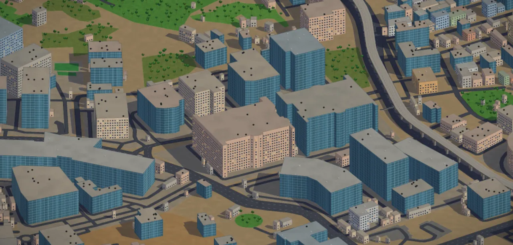

**[At a glance](#at-a-glance)** · **[The map](#the-map)** · **[Home search](#home-search-in-progress)** · **[Branches](#branches)** · **[How it works](#how-it-works)** · **[Run it](#run-it)** · **[Data and honesty](#data-and-honesty)**

</div>

---

## At a glance

| | |
|---|---|
| 🗺️ **Area** | A 52 km × 46 km grid of 2,392 one-km tiles, all rendered and validated: roughly everything inside the Outer Ring Road |
| 📐 **Projection** | 2:1 dimetric, 4 art pixels per metre, one exact projection for the whole city |
| 🧱 **Tiles** | 783,097 raster art tiles (2.42 GB PMTiles) plus a 636 MB vector overlay of buildings, roads and places |
| 🔍 **Zoom** | 9 (the whole city) to 20 (street level) |
| 🔎 **Search** | 15,970 places, streets and buildings, plus company sites |
| 🌆 **Looks** | Dusk (default) and day |
| 🏠 **Home search** | 20 gated societies and 120 PGs around HITEC City and Gachibowli |

---

## The map

### The whole city in one projection

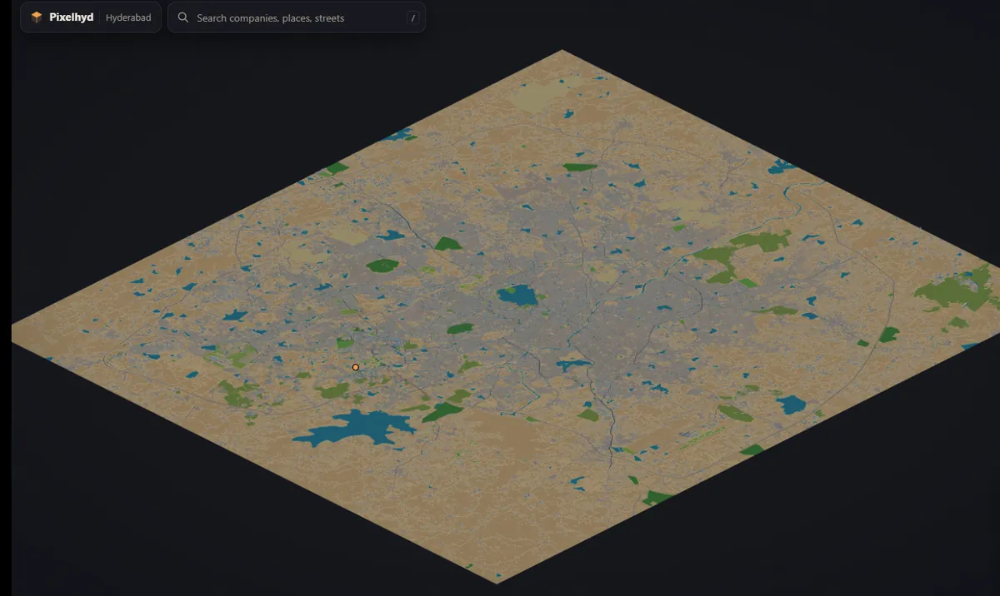

The grid started as a 5 km square around HITEC City and grew outward ring by ring. Every tile uses the same projection, palette, light and pinned data release, so all 2,392 tiles join without seams.

### Dusk and day

<table>
  <tr>
    <td width="50%">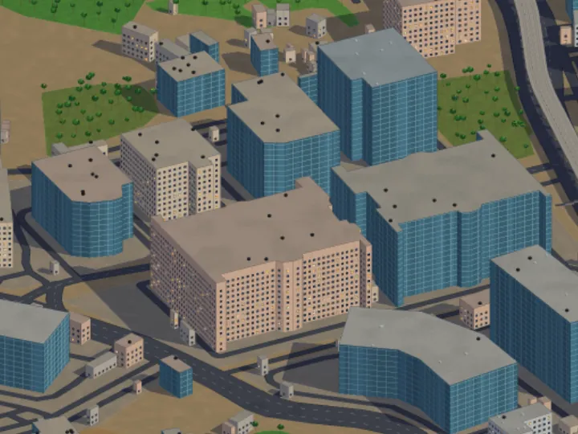</td>
    <td width="50%"></td>
  </tr>
  <tr>
    <td align="center"><b>Dusk</b> (default)</td>
    <td align="center"><b>Day</b></td>
  </tr>
</table>

Dusk is applied in the browser, in web workers, to the finished art, so nothing is re-rendered. It has four layers:

- a palette grade;
- surface textures from zoom 17;
- building and tree details from zoom 19;
- street life and pocket parks at full zoom.

Switch it off in the map settings to see the original day art.

### Search the city

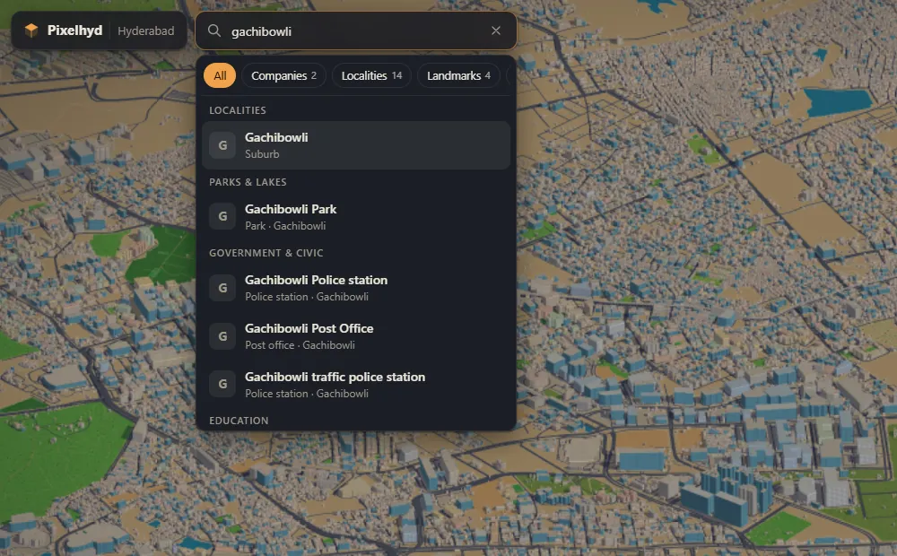

Press <kbd>/</kbd> to search companies, localities, streets, buildings and more. Results are grouped by kind, with tabs to filter them. Use <kbd>↑</kbd> <kbd>↓</kbd> and <kbd>Enter</kbd> to fly to a result, and <kbd>Esc</kbd> to close the list.

<details>
<summary><b>What is in the search index</b> (15,970 entries)</summary>

<br>

| Kind | Entries | | Kind | Entries |
|---|---:|---|---|---:|
| Buildings | 4,448 | | Offices | 792 |
| Streets | 3,441 | | Parks | 512 |
| Localities | 2,428 | | Civic | 299 |
| Education | 1,043 | | Shopping | 278 |
| Health | 1,039 | | Landmarks | 230 |
| Places of worship | 1,038 | | Campuses | 226 |
| | | | Transit | 196 |

Names come from OpenStreetMap and Overture places. Built by `hitec-pipeline places`.
</details>

### Companies and buildings

<table>
  <tr>
    <td width="50%">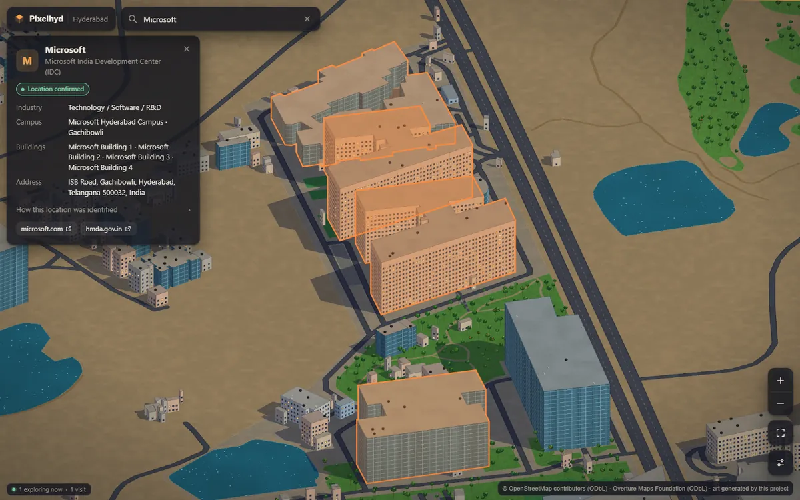</td>
    <td width="50%">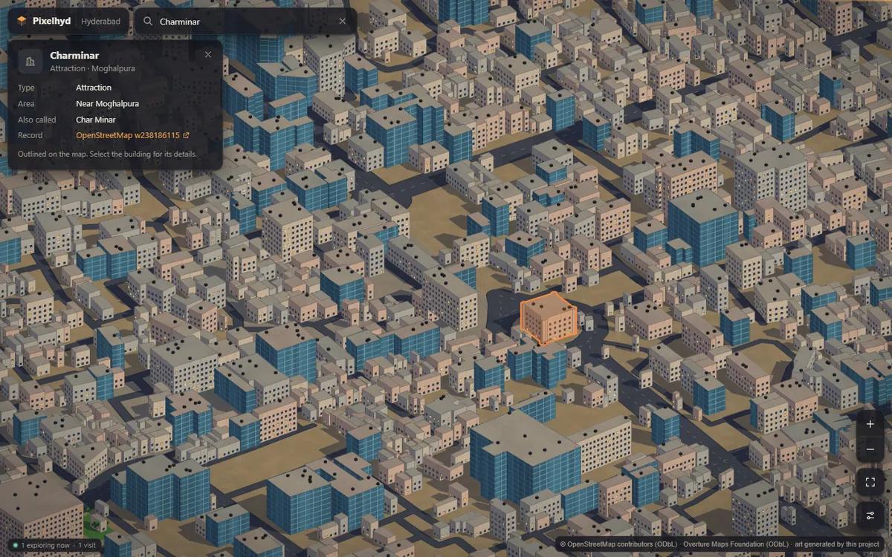</td>
  </tr>
  <tr>
    <td align="center">A company site with its confidence label</td>
    <td align="center">The Old City, around Charminar</td>
  </tr>
</table>

- **Company sites.** A company appears on the map only when its record can be tied to real OSM buildings by name. The research holds 9 companies with 9 office sites and 5 unpublished leads. Two sites are on the map today:
  - Microsoft, **Confirmed**: its campus and 4 named buildings.
  - Wells Fargo, **Unverified**: one named tower, not yet tied to the record's address.
- **Building cards.** Click any building to see what is known about it, including where its height comes from: verified, derived, modelled or estimated.
- **Shareable views.** The URL keeps the position and zoom, so any view can be shared as a link.
- **Phone layout.** On a phone the controls and cards rearrange for a small screen.
- **Visit counter.** It shows how many people are exploring now, and the total number of visits.
  - It uses no cookies and stores nothing in the browser.
  - A visitor is recognised for at most 30 minutes, by a hash with a salt that changes daily.
  - Only the total is kept.

---

## Home search (in progress)

> [!NOTE]
> Home search was merged into `main` in [PR #1](https://github.com/Ppp2048/pixelhyd/pull/1); later work arrived in [PR #3](https://github.com/Ppp2048/pixelhyd/pull/3). Turning it off gives back the plain map, pixel for pixel.

Pick where you work. Pixelhyd then checks the homes around it against your preferences and lights them up on the map, with a reason for every verdict.

<table>
  <tr>
    <td width="50%">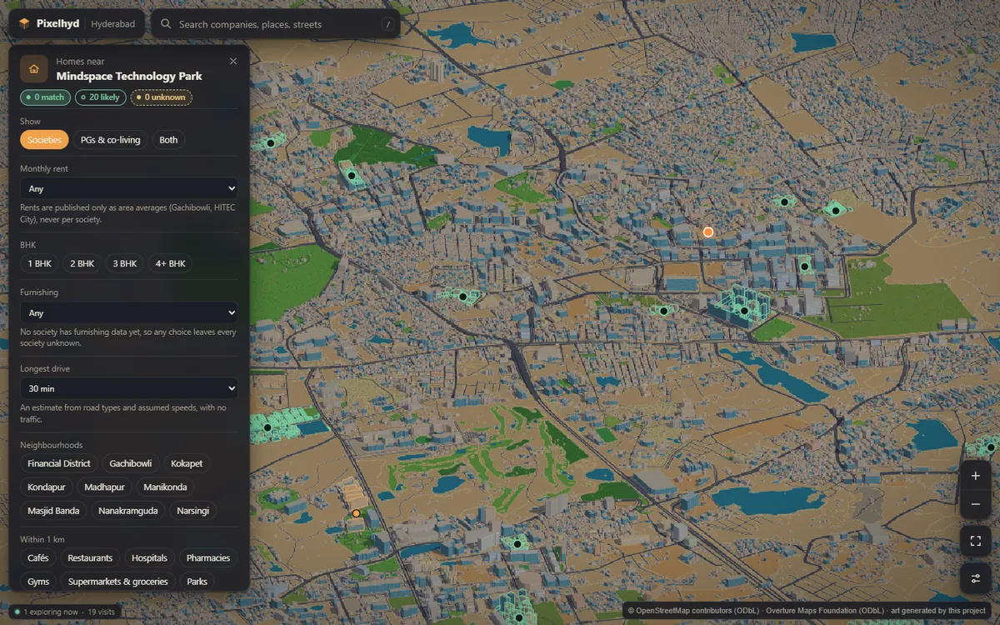</td>
    <td width="50%">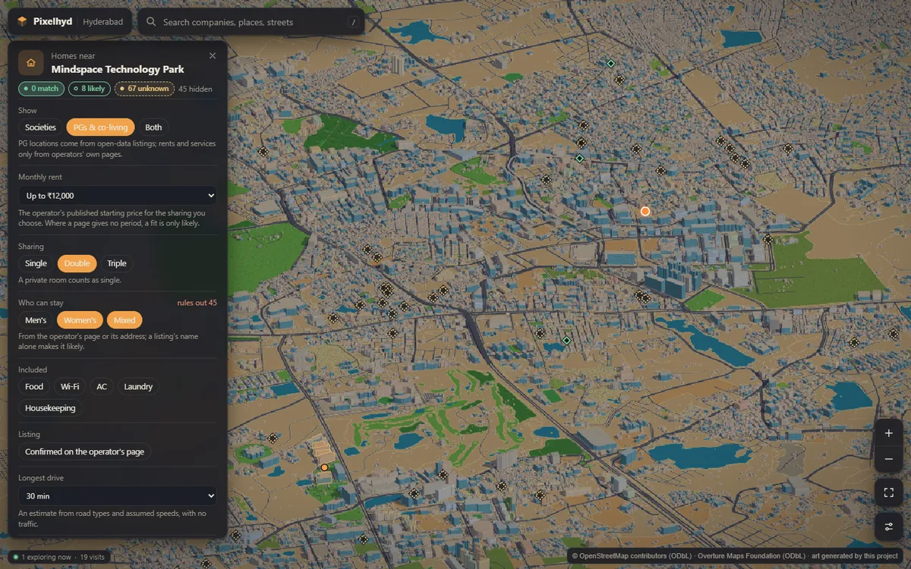</td>
  </tr>
  <tr>
    <td align="center"><b>Societies</b>: budget, BHK, furnishing, commute, neighbourhood</td>
    <td align="center"><b>PGs and co-living</b>: rent, sharing, who can stay, what is included</td>
  </tr>
  <tr>
    <td width="50%">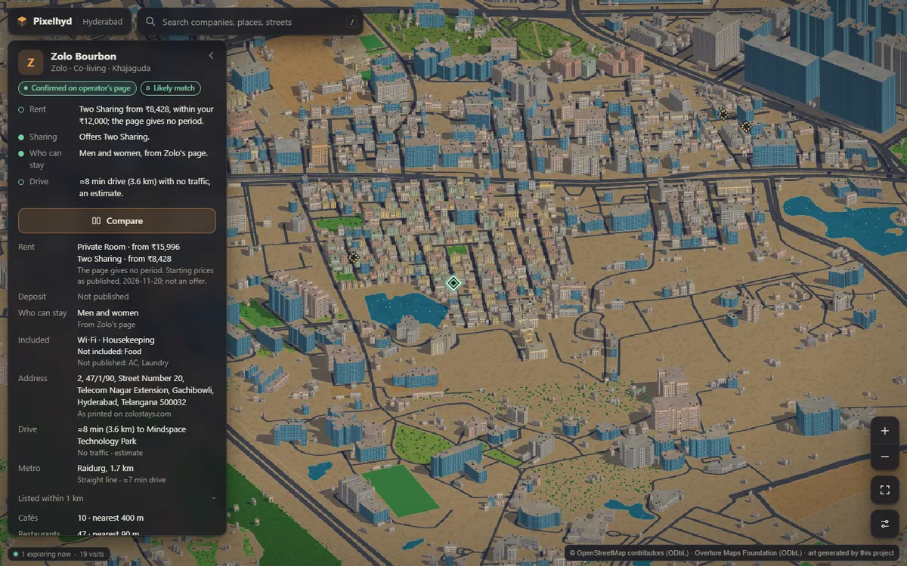</td>
    <td width="50%">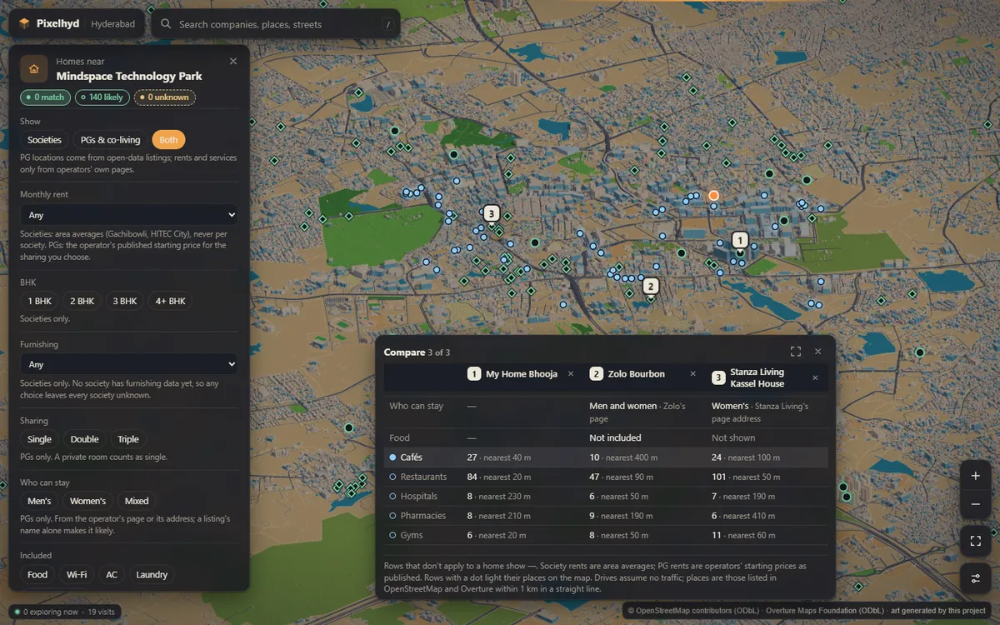</td>
  </tr>
  <tr>
    <td align="center"><b>Cards</b> with every fact's source</td>
    <td align="center"><b>Compare up to 3</b> homes, with nearby places lit on the map</td>
  </tr>
</table>

| | Societies | PGs and co-living |
|---|---|---|
| **Homes** | 20 gated societies, 8 researched in depth | 120 PGs: 11 confirmed from operators' pages, 30 probable, 79 unverified |
| **Rent** | Area averages for 11 curated neighbourhoods, never one society's rent | The operator's published starting price for the sharing you choose |
| **Filters** | Budget, BHK, furnishing | Budget, sharing, who can stay, food and services, listing status |
| **Commute** | Drive time from a 250 m grid of workplaces. It is an estimate without traffic. | Same |
| **Around it** | Nearest metro station, and places such as cafés, restaurants, hospitals, pharmacies and gyms within 1 km | Same |

<details>
<summary><b>How a home gets its verdict</b></summary>

<br>

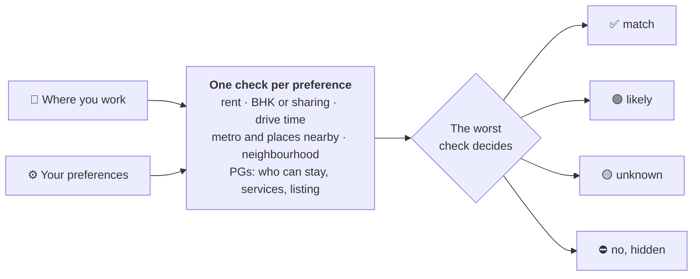

| Verdict | Meaning |
|---|---|
| ✅ **match** | Every check is met by published data. |
| 🟢 **likely** | Probably met, but something rests on an average or an indirect source, such as an area's average rent. |
| 🟡 **unknown** | Some data is not published, so the check cannot be decided. Unknown never counts as a pass. |
| ⛔ **no** | A check fails, for example over budget or too far. The home is hidden, and the panel says which preference ruled out how many homes. |

</details>

<details>
<summary><b>On a phone</b></summary>

<br>

<p align="center">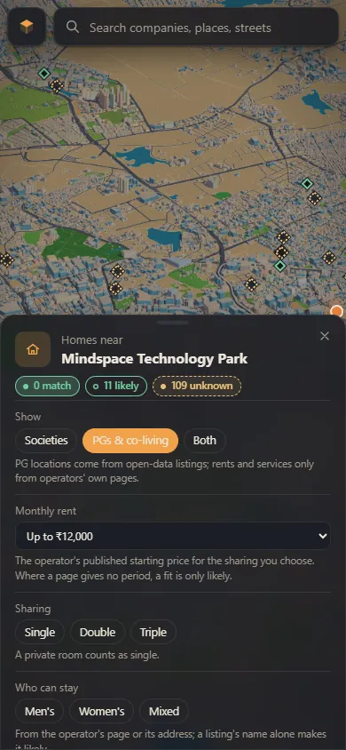</p>

</details>

---

## Branches

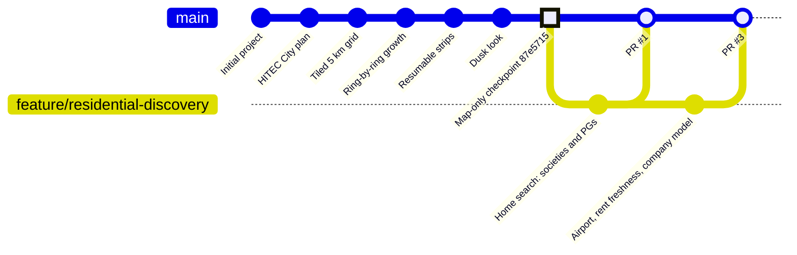

| Branch | What it is |
|---|---|
| **`main`** | The working app: the whole city, dusk and day looks, search, company sites, building cards, the visit counter, home search (PR #1), and the airport, rent freshness and company data model (PR #3). |
| **`feature/residential-discovery`** | Where home search, company offices and map fixes are developed before they reach `main`. |
| commit **`87e5715`** | The map-only checkpoint from before home search. You can return to it at any time. |

```bash
git switch main                              # the current app
git switch feature/residential-discovery     # work in progress
git switch --detach 87e5715                  # the map-only checkpoint
```

---

## How it works

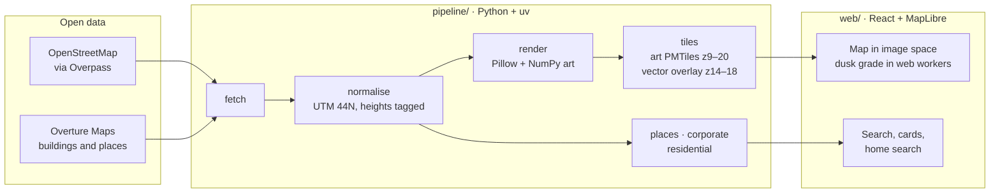

**Projection.** Positions go from WGS 84 to UTM zone 44N metres, then through one exact affine map to 2:1 dimetric art pixels:

```math
\begin{aligned}
x &= k\,(e - n) + o_x \\
y &= -\tfrac{k}{2}\,(e + n) - v\,z + o_y, \qquad v = k\,\tfrac{\sqrt{6}}{2}
\end{aligned}
```

Here $e$ and $n$ are metres east and north of the area's south-west corner, $z$ is height, and $k = 4$ art pixels per metre. One metre east moves $(+k, -k/2)$ pixels.

**Image space.** MapLibre only draws Web Mercator, so the art is placed at longitude 0, latitude 0 of a Mercator world sized so that one art pixel is one screen pixel at the top zoom. Search results, cards and highlights use the same maths, so they line up with the art to floating-point precision. The Python version ([`iso.py`](pipeline/src/hitec_pipeline/iso.py)) and the TypeScript version (`web/src/lib/projection.ts`) are tested against pyproj.

**Art.** The renderer uses Pillow and NumPy, with its own palette and light. Buildings are extruded prisms with three-tone shading, window textures mapped onto each face and roof details. Any randomness is seeded per feature, so a re-render is identical. Rendering in chunks gives exactly the same pixels as one whole-canvas render (`pipeline/tests/test_seams.py`).

**Growing the city.** Tiles are rendered in parallel, in strips of neighbours that each publish when they finish. The open app picks up each new version within a minute. A batch that stops partway resumes from its last finished job. Chosen tiles can be re-rendered on their own; only their lower-zoom overview tiles are rebuilt with them.

<details>
<summary><b>Coverage map</b>: the rendered grid, the original 5 km square and the home-search area</summary>

<br>

```geojson
{
  "type": "FeatureCollection",
  "features": [
    {
      "type": "Feature",
      "properties": { "name": "Rendered city grid", "about": "2,392 tiles of 1 km, aligned to UTM 44N", "stroke": "#e76f51", "stroke-width": 2, "fill": "#f4a261", "fill-opacity": 0.08 },
      "geometry": { "type": "Polygon", "coordinates": [[[78.21936, 17.19115], [78.7079, 17.1973], [78.70272, 17.61277], [78.21307, 17.60646], [78.21936, 17.19115]]] }
    },
    {
      "type": "Feature",
      "properties": { "name": "Home-search area", "about": "Societies, PGs, drive times and nearby places (strip plus margin)", "stroke": "#2a9d8f", "stroke-width": 2, "fill": "#2a9d8f", "fill-opacity": 0.12 },
      "geometry": { "type": "Polygon", "coordinates": [[[78.30, 17.37], [78.43, 17.37], [78.43, 17.50], [78.30, 17.50], [78.30, 17.37]]] }
    },
    {
      "type": "Feature",
      "properties": { "name": "Original 5 km square", "about": "Where the grid started: HITEC City, tiles r0c0 to r4c4", "stroke": "#264653", "stroke-width": 3, "fill": "#264653", "fill-opacity": 0.15 },
      "geometry": { "type": "Polygon", "coordinates": [[[78.35691, 17.42782], [78.40394, 17.42843], [78.4033, 17.47358], [78.35626, 17.47296], [78.35691, 17.42782]]] }
    },
    {
      "type": "Feature",
      "properties": { "name": "Charminar", "about": "Old City landmark, from the search index", "marker-color": "#e76f51", "marker-symbol": "monument" },
      "geometry": { "type": "Point", "coordinates": [78.47464, 17.3616] }
    }
  ]
}
```

</details>

---

## Run it

**Requirements:** Python 3.14 with [uv](https://docs.astral.sh/uv/), and Node 24 with npm. You don't need GDAL, Blender or a GPU.

> [!IMPORTANT]
> Map tiles and downloaded data are not in git (`data/` and `web/public/tiles/` are ignored). Build them with the pipeline first. The whole city is about 3 GB, so the small `prototype` area is the quick way to try it.

```bash
# 1. Pipeline: data → art → tiles
cd pipeline
uv sync
uv run hitec-pipeline fetch --area prototype       # Overture + OSM for a 250 m prototype
uv run hitec-pipeline normalise --area prototype
uv run hitec-pipeline render --area prototype --k 4 --chunk 512

# search, company and home-search data
uv run hitec-pipeline places
uv run hitec-pipeline corporate
uv run hitec-pipeline residential                  # societies, PGs, drive times, nearby places

# 2. Web app
cd ../web
npm install
npm run dev                                        # http://localhost:5173
```

<details>
<summary><b>Rendering the city, tile by tile</b></summary>

<br>

The map is a grid of 1 km tiles. The original 5 km square is `r0c0` (south-west) to `r4c4` (north-east). The grid keeps that alignment and grows ring by ring over the city box `tiles.CITY_WSEN`, so outer tiles have ids such as `r-1c7`. Progress is kept in `data/tiles/hitec-city/index.json`.

```bash
uv run hitec-pipeline tiles status                  # map of pending / validated / failed tiles
uv run hitec-pipeline tiles batch --count 24        # the next 24 tiles outward, in parallel
uv run hitec-pipeline tiles batch r-1c2 r-1c3       # specific tiles; validated ones are skipped unless --force
uv run hitec-pipeline tiles batch r2c3 --rerender   # re-render without touching the tile's data
uv run hitec-pipeline tiles run                     # just the next tile
```

- **Strips.** Large batches are split into strips of neighbouring tiles that each publish when done. The default is `--step 16`; `--step 0` runs one batch.
- **Workers.** `--workers N` sets the number of processes. The default is the CPU count minus 2, at most 6, and each process needs about 0.5 GB.
- **Data downloads.** Raw data is downloaded once per 5 km block and then cut per tile.
- **Incremental updates.** The archives are updated incrementally, and the app shows the grid as the "Hyderabad" dataset.

</details>

<details>
<summary><b>Tests and checks</b></summary>

<br>

```bash
cd pipeline && uv run pytest          # projection, seams, tiles, places, companies, homes
cd web && npx vitest run              # projection, search, verdict rules, URL state
cd web && npm run lint                # oxlint
cd web && npm run build               # type check + production build
```

</details>

<details>
<summary><b>Deploying</b></summary>

<br>

Pixelhyd is live at **[pixelhyd.pages.dev](https://pixelhyd.pages.dev)**. Deploys are made by hand with wrangler; nothing deploys automatically when `main` changes, so the live site can be behind `main`. It was last deployed on 2026-11-27 from `main` at `a1aefc9`. The steps are in [docs/deploy.md](docs/deploy.md):

| Part | Where |
|---|---|
| The site and its data files | Cloudflare Pages |
| The map tiles (about 3 GB) | Cloudflare Pages, cut into 256 KiB chunk files (`hitec-pipeline deploy`) |
| The visit counter (`/api/visits`) | A Pages Function with a D1 database |

As alternatives, `npm run build:deploy && npm start` runs one Node server with the counter in SQLite, and a bucket that answers range requests (such as R2) can serve the archives whole.

</details>

---

## Data and honesty

| Source | Used for | Licence or terms |
|---|---|---|
| **OpenStreetMap**, via Overpass (snapshot 2026-11-15) | Roads, rail and metro, building names, levels and heights, places, neighbourhoods | ODbL |
| **Overture Maps** (release 2026-10-21) | Building footprints, places for search, PG listings and nearby places | ODbL (buildings), CDLA-Permissive-2.0 (places) |
| **Operators' own pages** | PG rents, sharing and services, read only where the operator's terms allow it | The operator's terms; each fact links its page |
| **This project's research** | Company offices, society details, neighbourhoods, area rent averages | Cited per record |

Principles the code and the interface follow:

- **Verified, estimated and unknown are kept apart.**
  - Building heights carry a source and a confidence.
  - Drive times say they are estimates without traffic.
  - Missing facts show as unknown instead of being filled in.
- **Nothing is invented.** There are no made-up rents, availability, room sizes, commute times, companies, addresses or building links.
- **Google Maps content is not used as a data source.**
- **Access rules are respected.** Pages behind CAPTCHAs or bot protection are not read. Nor are operators' pages whose terms forbid reading: their PGs stay on the map, with the page marked "(not read)".
- **Visitors stay anonymous.** The visit counter keeps one number. No IP address or browser name is stored.

---

## Repository layout

| Path | What |
|---|---|
| [`pipeline/`](pipeline) | Python (uv) pipeline, run as `hitec-pipeline` |
| [`pipeline/src/hitec_pipeline/`](pipeline/src/hitec_pipeline) | Modules: `fetch`, `normalise`, `iso`, `render`, `tiles` and `batch` for the map; `places` and `corporate` for search; `residential`, `pgs`, `commute` and `amenities` for home search |
| [`pipeline/corporate/`](pipeline/corporate) | Company research: `companies.json`, `sites.json`, `leads.json`, and the original seed and v1 files in `legacy/` |
| [`pipeline/residential/`](pipeline/residential) | Home-search research: societies and PGs |
| [`web/src/map/`](web/src/map) | MapLibre view, image-space projection, the dusk look (`duskCore`, workers) |
| [`web/src/ui/`](web/src/ui) | Search, cards, settings, home search panel, comparison |
| [`web/src/lib/`](web/src/lib) | Projection, search and verdict logic, URL state |
| [`web/functions/`](web/functions), [`web/server/`](web/server) | The visit counter, on Cloudflare Pages Functions or Node |
| [`docs/`](docs) | Deploy guide, data guide, plans and reports, README images ([index](docs/README.md)) |
| `data/` | Downloaded and generated data, not committed |

---

<div align="center">

**Attribution:** map data © [OpenStreetMap](https://www.openstreetmap.org/copyright) contributors (ODbL) · [Overture Maps Foundation](https://overturemaps.org/) (ODbL buildings, CDLA-Permissive-2.0 places).<br>
The artwork is generated by this project's own rules. Processed map data published from this project stays under ODbL.<br>
No licence has been chosen for the code yet.

</div>
