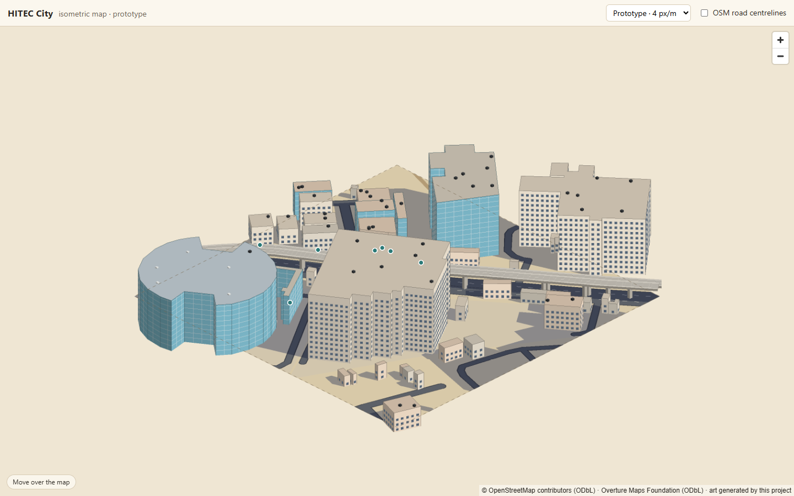

# Prototype Report — 250 m × 250 m, HITEC City

- **Date:** 2026-11-15
- **Area:** 250 m UTM square centred on 17.4499 °N, 78.3822 °E (between Cyber Towers and the HITEC City metro station), data fetched with a 150 m buffer.
- **Plan:** `implementation-plan.md` (Phase 1). Screenshots: `prototype-screenshots/`.
- **Tags:** [V] measured/verified · [I] inferred · [U] still uncertain.

## Result
The full chain works end to end on this laptop: **real data → exact projection → procedural isometric art → tiled archive → interactive MapLibre app**. All eight prototype steps pass their checks (table below). The main weakness is not engineering but data: **173 of 175 building heights are estimates**, so the skyline is not yet trustworthy.



## Acceptance checks
| Step | Check | Result |
|---|---|---|
| 1. Extract | Overture + OSM for the buffered box, provenance manifest | ✅ 175 Overture buildings (47 KB GeoParquet), OSM 191 KB JSON; manifest with query, time, OSM base timestamp and SHA-256 [V] |
| 2. Normalise | Projected, validated, deduplicated, height source per building | ✅ 0 invalid, 0 duplicates, 0 heavy overlaps; 72 buildings joined to OSM tags; every building has `height_source` + `height_confidence` [V] |
| 3. Project | Round-trip < 1 cm; roads align within 1 px | ✅ pytest round-trip < 1 cm; browser UTM maths matches pyproj < 1 mm (Vitest); OSM centrelines sit on the rendered road centres at 2.4× zoom (screenshot) [V] |
| 4. Render | k = 2 and k = 4; chunked render with no seams | ✅ Pixel-identical to a whole-canvas render at 256, 333 and 700 px chunks (pytest) — after fixing two Pillow rasterisation pitfalls (below) [V] |
| 5. Style | Palette, light, windows, shadows, trees | ✅ v1 (49 colours, south-south-east light, glass/punched facades, rooftop tanks and AC units, elevated metro + flyover with pillars). Trees: code path built but no green areas in this box [V]. **Needs your visual review** |
| 6. Tile | PMTiles with correct bounds/zooms | ✅ k4: 48 tiles, 122 KB, zooms 17–20; k2: 17 tiles, 53 KB [V] |
| 7. App | Image-space MapLibre, hover/click inspector, zoom/pan, URL state | ✅ Hover outline, click → inspector with height confidence + OSM link; `?d,lat,lon,z,b` in real coordinates, restored on load (shared building link verified) and on Back [V] |
| 8. Measure | Render < 1 min, RAM < 1 GB, 60 fps, first view < 1 MB | ✅ see below [V] |

## Measurements [V]
| Metric | k = 4 | k = 2 |
|---|---|---|
| Canvas | 2016 × 1300 px | 1016 × 658 px |
| Scene build / render | 0.7 s / 0.3 s (512 px chunks) | 0.7 s / 0.14 s |
| Tile encode | 0.35 s | < 0.2 s |
| Peak pipeline memory | 179 MB | 152 MB |
| Tiles (all zooms) | 48 · 122 KB | 17 · 53 KB |
| Colours in art | 49 | 49 |

Web app, production build, headless Chromium 1440 × 900:
| Metric | Value |
|---|---|
| First view transfer (all files) | 566 KB, of which art 52 KB |
| All visible tiles loaded | 0.8 s after navigation (local server) |
| Pan / zoom-in / zoom-out | 60 / 60 / 60 fps, worst frame 18 ms |
| JS heap | 61 MB |
| Bundles | app 1.31 MB (370 KB gzip) + MapLibre worker 519 KB |

### Projection to the full 5 km × 5 km [E]
The area is 400× larger. Linear scaling gives roughly **1–2 min of rendering, ~20,000 tiles and 50–150 MB** at k = 4 (measured average 2.5 KB per tile, but the dense centre will be heavier), well inside the disk budget. Chunked rendering keeps memory flat.

## Problems found and fixed during the prototype
| Problem | Cause | Fix |
|---|---|---|
| Thin lines through roofs | Corner outlines of concave buildings were drawn after the roof | Draw each corner line with its wall, before the roof |
| Wrong overlap between touching buildings (risk) | Single "nearest point" depth key | Pairwise occlusion test on shared screen columns + topological sort |
| **Seams between chunks** (580 px differed) | (1) Pillow rounds vertices asymmetrically for negative coordinates; (2) Pillow truncates span ends toward zero, leaking one pixel at column 0; (3) degenerate polygons at the border | Snap every vertex to the global pixel grid before drawing; render with an 8 px margin and crop; skip zero-area polygons. Now covered by `tests/test_seams.py` |
| Tile encoding 33 s | WebP `method=6` | `method=2`, still lossless (100× faster) |
| Map blank in the browser | MapLibre 6 module worker broken by Vite pre-bundling (dev) and not emitted (build); MapLibre CSS overriding the container size; `NaN` in GeoJSON | `optimizeDeps.exclude`, `?worker&url` + `setWorkerUrl`, explicit container size, JSON sanitising with `allow_nan=False` |

## What the prototype proved
1. **MapLibre in image space works** (decision D2): exact Mercator placement at lon 0/lat 0, `raster-resampling: nearest`, PMTiles via `url:` with header zooms, vector hit-testing on building silhouettes. No fallback needed.
2. **Exact geography is preserved end to end:** WGS84 → UTM 44N → art pixels → image-space lon/lat and back, identical in Python and TypeScript.
3. **Seamless chunking** is now guaranteed by a test, so the full area can be rendered in bounded memory.
4. **Honest data UI:** the inspector shows "ESTIMATED" in red for guessed heights and links to the OSM source record.

## Limitations and open issues
| Issue | Impact | Next step |
|---|---|---|
| **Heights: 2 derived, 173 estimated** (OSM/Overture have almost none here) | Skyline not trustworthy (e.g. Broadridge shown at an estimated 50 m) | Phase 2: Google Open Buildings 2.5D (D4 — I will report the download size first) |
| Buildings crossing the area edge are drawn whole and spill outside the square | Untidy edges | Clip to a soft edge for the final map, or accept as a "diorama" edge |
| Shadows fall on the ground only, not on lower roofs or walls | Minor realism | Optional later |
| Flyover ramp heights and metro deck height are estimates (13 m / 7 m) | Elevation approximate | Use OSM `layer` + a cited height table; stations as dedicated structures |
| No trees rendered in this box (no green areas) | Untested visually | Phase 2 test area includes parks / Durgam Cheruvu |
| Overture CLI took ~2 min for a tiny box [V]; Overpass needed retries | Slow fetch | For 25 km², one fetch, cached; time it in Phase 2 |
| Main JS bundle 370 KB gzip | Load time on mobile | Code-split MapLibre + lazy load |
| Art style is functional but plain | Product identity | Your review → art pass (roof variety, road markings, ground textures, palette) |
| Telugu labels, search, filters | Not in prototype scope | Phase 4 |
| Tested in Chromium only | — | Phase 5 |

## Decisions now needed
| # | Decision | Recommendation |
|---|---|---|
| D3 | Art resolution | **k = 4** (windows and decks readable; storage still small). k = 2 looks more "pixel-art" but loses façade detail — see `prototype-screenshots/compare-k2-left-k4-right.png` |
| D4 | Building heights | Approve investigating the Open Buildings 2.5D download for this area (size reported before downloading) |
| — | Visual direction | Your feedback on the v1 style (colours, light, density) before the art pass |
| — | Commit | The prototype code is not committed yet |

## How to reproduce
```bash
cd pipeline
uv run hitec-pipeline fetch --area prototype
uv run hitec-pipeline normalise --area prototype
uv run hitec-pipeline render --area prototype --k 4 --chunk 512
uv run pytest
cd ../web && npm run dev   # open http://localhost:5173
```
